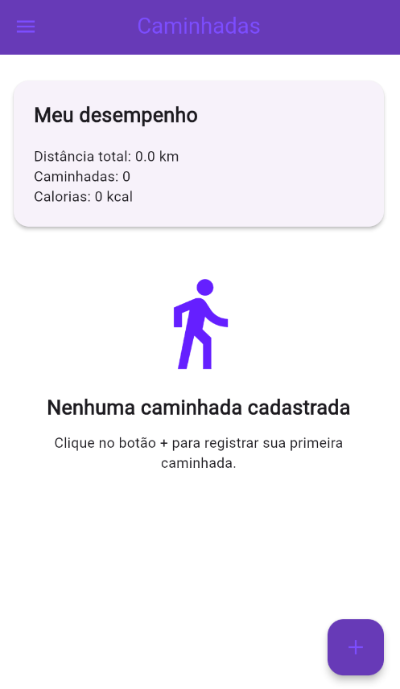
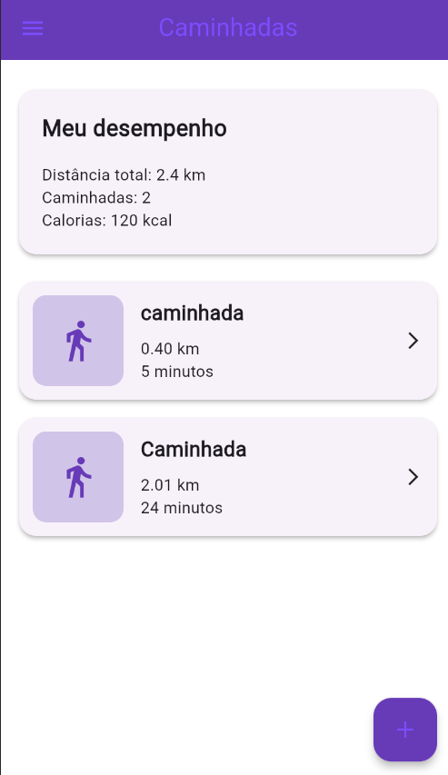

# Widget Personalizado — Aplicativo Caminhadas

## 1. Objetivo

O objetivo desta atividade foi desenvolver um widget personalizado utilizando Flutter, integrando informações relevantes ao aplicativo Caminhadas.

O componente foi desenvolvido para apresentar um resumo do desempenho do usuário, permitindo visualizar rapidamente os dados das caminhadas cadastradas.

## 2. Tecnologias utilizadas

- Flutter
- Dart
- Material Design
- Pacote `home_widget`
- Kotlin
- XML

## 3. Desenvolvimento

Foi criado o arquivo `meu_info_widget.dart`, localizado na pasta `lib/widgets/`.

O componente utiliza a classe `StatelessWidget` e recebe três informações por parâmetros:

- Distância total percorrida, em quilômetros.
- Quantidade de caminhadas cadastradas.
- Total de calorias acumuladas.

Para organizar as informações, foram utilizados componentes nativos do Flutter, como `Card`, `Padding`, `Column` e `Text`.

## 4. Integração com a tela principal

O widget personalizado foi integrado à tela principal do aplicativo, localizada em `lib/pages/home.dart`.

Foram implementados cálculos para somar automaticamente as distâncias e calorias de todas as caminhadas cadastradas.

Dessa maneira, sempre que uma caminhada é adicionada, os valores apresentados no componente são atualizados.

## 5. Home Screen Widget Android

Além do componente visual interno do Flutter, também foi desenvolvida uma integração com o pacote `home_widget`, permitindo disponibilizar informações do aplicativo em um widget da tela inicial do Android.

Foram criados:

- `MeuHomeWidget.kt`: responsável por exibir as informações no Android.
- `meu_home_widget.xml`: layout visual do widget.
- `meu_home_widget_info.xml`: configurações do widget.
- `widget_service.dart`: responsável por calcular e enviar os dados.
- Configuração do `AndroidManifest.xml`: registro do componente Android.

## 6. Captura de tela

A imagem abaixo demonstra o componente personalizado integrado à tela principal do aplicativo.

## 7. Testes realizados

Foram realizados testes para verificar:

- Exibição correta das informações.
- Apresentação dos valores iniciais.
- Integração com a tela principal.
- Atualização dos dados após o cadastro de caminhadas.

Os testes do componente personalizado foram realizados com sucesso.

## 8. Conclusão

A atividade permitiu aplicar os conceitos de criação e reutilização de widgets no Flutter, utilizando parâmetros para transmitir informações entre componentes.

Também foi possível explorar a integração entre Flutter e Android por meio do pacote `home_widget`, ampliando as funcionalidades do aplicativo Caminhadas.# flutter_caminhadas_Widgets
# flutter_caminhadas_Widgets
